# Revisão do vídeo ORLANDO-leve.mp4 contra o Plano Mestre v2

## Para quem é este documento

Este relatório é para outro Claude (ou qualquer revisor) que vai agir sobre as divergências entre o **PLANO MESTRE: VLOG ORLANDO (LOJAS DE CÂMERA) v2** e o vídeo que o editor entregou. Cada achado traz: o que o plano diz (com a seção), o que o vídeo mostra (com tempo exato), a evidência (imagem ou número), como o achado foi feito, o grau de confiança e uma sugestão. Nada aqui foi inventado: onde eu não tenho certeza, está escrito.

## O que foi revisado

Arquivo recebido: `ORLANDO-leve.mp4`, versão leve do export (H.264, **854×480, 24 fps**, áudio AAC, **duração 682,29 s = 11:22**, 65,3 MB). Não é o export original: é uma versão de baixa resolução enviada pelo Cristian porque o arquivo original tem cerca de 1 GB. O plano pede animações em 1920×1080 e 30 fps, então resolução e fps do original **não puderam ser conferidos**.

## Como foi feito (método)

1. **Um frame por segundo**, os 682 segundos, todos olhados (folhas de contato de 20 frames) e anotados na tabela `revisao_segundo_a_segundo.md`.
2. **Transcrição com tempo por palavra** (Whisper modelo `medium` via faster-whisper, português). Arquivo: `transcricao_palavra_por_palavra.txt`. Os tempos por palavra são **aproximados** (o próprio plano avisa que transcrições têm tempos imprecisos). Valores em reais que aparecem na transcrição são erro do reconhecimento: os cards do vídeo usam "US$".
3. **ffmpeg**: `freezedetect` (n=-60dB, d=2) para imagem congelada; `blackdetect` para tela preta (nenhuma); `silencedetect` a -40 dB por 1,2 s (nenhum trecho); detecção de troca de cena (limiar 0,18: 266 cortes de imagem).
4. **Nível de áudio** por 10 ms e por 1 s para achar quedas bruscas de volume (cortes secos) e trechos quase silenciosos.
5. Onde um card ou etiqueta parecia ter texto errado em 480p, o frame foi **ampliado** para confirmar antes de afirmar (um caso foi descartado assim: a etiqueta "R5C" está correta).
Eu **não consigo ouvir** o áudio: tudo que é sobre som vem de números (nível em dB, tempos de palavras). Por isso os achados de áudio têm um grau de confiança e pedem conferência de ouvido.

## Limites desta revisão

- Não tenho os arquivos `.json` das falas nem os clipes originais (2087, 2088, 1994, 2099 etc.). Portanto **não pude conferir cada corte do plano em segundos de cada clipe** nem a tolerância de 0,15 s contra o `.json`. Só verifiquei cortes pelo áudio do vídeo final.
- As narrações V03 a V09 são opcionais no plano e eu não consigo distinguir quais entraram.
- Não medi o duck de 12 dB da narração nem identifiquei a música.
- Fonte, cores e canal alfa das animações não foram conferidos (só o vídeo final foi analisado).
- Travessão: nenhum visto nos frames, mas o texto riscado do tracker (4:48 a 4:55) dificulta ver o separador.
- Os tempos de início/fim das palavras podem errar em dezenas de milissegundos.

## Legenda

**Severidade**: Alta = quebra uma promessa do plano ou o vídeo ao espectador; Média = erro visível ou regra do plano violada; Baixa = detalhe. **Confiança**: Alta = visto direto na imagem ou medido; Média = depende de tempos aproximados ou de interpretação; Baixa = precisa de conferência humana. "Apresentador" é a pessoa que aparece no carro (o plano a chama de Cristian em alguns trechos).

## Resumo dos achados

| ID | Tempo no vídeo | Achado | Severidade | Confiança |
|---|---|---|---|---|
| [F01](#f01) | 10:37 a 11:01 | A revelação da câmera não mostra a câmera | Alta | Alta |
| [F02](#f02) | 10:46 a 11:01 | 16 segundos sem fala e quase sem som, sobre imagem parada | Média | Alta |
| [F03](#f03) | 10:11 a 10:38 | Ponte V10 e card C10 ausentes: a fala salta de "loja muito incrível" para "Uma marca pessoal" | Média | Alta |
| [F04](#f04) | 10:37,69 (e outros) | Cortes secos de áudio: um cai dentro de uma palavra | Alta | Média |
| [F05](#f05) | 5:37 a 5:46 | Lembrete único da promessa (S11) não foi encontrado | Média | Média |
| [F06](#f06) | 0:03 e 8:30 | Preço da Canon EOS R1: card mostra US$ 6.799, o plano e a fala dizem US$ 7.000 | Média | Alta |
| [F07](#f07) | 7:14 a 7:16 | Godox AD600: card US$ 900, plano diz US$ 800, e o preço não é dito | Média | Alta |
| [F08](#f08) | 3:40 a 3:42 | Canon R5 Mark II: card US$ 5.349, plano e fala dizem 5 mil | Baixa | Alta |
| [F09](#f09) | 2:03 a 2:06 | Card da família: grafia "ANDREZA" e dois cards fundidos em um | Média | Média |
| [F10](#f10) | 1:51 a 1:52 | Card "DOIS DIAS ANTES · BEST BUY": a informação "dois dias" não está no plano | Média | Alta |
| [F11](#f11) | 10:12 a 10:13 | Card "MAIS CEDO, NA DISNEY SPRINGS" não está no plano | Média | Média |
| [F12](#f12) | 9:35 a 9:37 | Legenda "MESMO PREÇO DA B&H" sem atribuição | Baixa | Alta |
| [F13](#f13) | 0:53 a 0:55 | Card "LOJA 1: HARMON PHOTO · SÓ USADOS": cita a loja e usa "SÓ", a fala diz "a maioria" | Baixa | Média |
| [F14](#f14) | 4:32 a 4:34 | Etiqueta "KODAK DIGITAL US$ 69" aparece uns 3 s antes de a fala dizer o preço | Média | Alta |
| [F15](#f15) | 9:24 a 9:27 | Etiqueta "MODIFICADOR DE FLASH US$ 60" sai quando a fala começa a dizer "60 dólares" | Média | Alta |
| [F16](#f16) | 7:57 a 8:02 | Citação "…mas gostaria de ter" sai antes de a frase ser dita | Baixa | Alta |
| [F17](#f17) | 1:14 a 1:18 | Mapa do trajeto mostra "7 MIN" cerca de 1 s depois de a fala dizer "7 minutos" | Baixa | Alta |
| [F18](#f18) | 0:00 a 0:03 | Possível desencontro de boca no começo do gancho | Baixa | Baixa |
| [F19](#f19) | 0:00 a 0:16 | Gancho sem o clipe da Kodak | Baixa | Alta |
| [F20](#f20) | 0:12 a 1:18 | Ordem e duração das animações de mapa/tracker diferem do plano | Baixa | Alta |
| [F21](#f21) | 4:47 a 4:55 e 1:52 a 1:57 | Duas pausas quase silenciosas sobre imagem sem movimento | Média | Alta |
| [F22](#f22) | 8:25 a 8:32 | Etiqueta da R6 Mark III ausente no clipe 2099 (só aparece na revelação) | Baixa | Média |
| [F23](#f23) | 7:37 a 7:44 | Etiqueta da sapata (US$ 7) não aparece | Baixa | Média |
| [F24](#f24) | 9:49 a 9:56 | Card C15 "Osmo em falta nesta loja" não aparece (e a imagem não o apoia claramente) | Baixa | Média |

## Achados detalhados

<a id="f01"></a>
### F01. A revelação da câmera não mostra a câmera

**Tempo no vídeo:** 10:37 a 11:01  
**Severidade:** Alta  
**Confiança:** Alta

**O que o plano diz:** Seção 3, bloco 7, **F4**: "V11 (revelação, slot 20 s): A8 de 4 s ('3, 2, 1, A CÂMERA QUE EU COMPREI'), depois imagem da câmera e das fotos do casamento (arquivos pendentes) e o clipe 2099 [7.06 a 10.56] (etiqueta da R6 Mark III) como prova." Seção 1: "Uma promessa aberta (revelação da câmera) é lembrada uma vez no meio e entregue no fim." Seção 7 (pendências): "fotos e vídeo da R6 Mark III e do casamento".

**O que o vídeo mostra:** Contagem 3, 2, 1 de 10:37,75 a 10:39,75; moldura "A CÂMERA QUE EU COMPREI" de 10:40 a 10:42; etiqueta CANON R6 MARK III US$ 2.799 de 10:41,75 a 10:44; a voz diz "2.799 dólares" (10:43,44 a 10:45,12). A partir de **10:48,17 o quadro é idêntico até 11:01,46** (13,3 s de imagem parada da vitrine). Não aparece foto nem vídeo da câmera comprada, não aparecem fotos do casamento e não aparece card do vlog do casamento.

**Evidência:** O `freezedetect` do ffmpeg retornou `freeze_start 648.167` com duração 10,42 s e depois `freeze_start 658.583` com 2,88 s, que somam o trecho 10:48 a 11:01. Frames abaixo (1: contagem; 2: moldura; 3: etiqueta; 4 e 5: o mesmo quadro parado, 10 s de diferença).

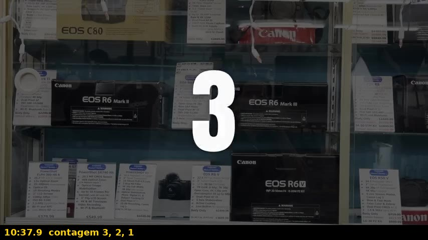

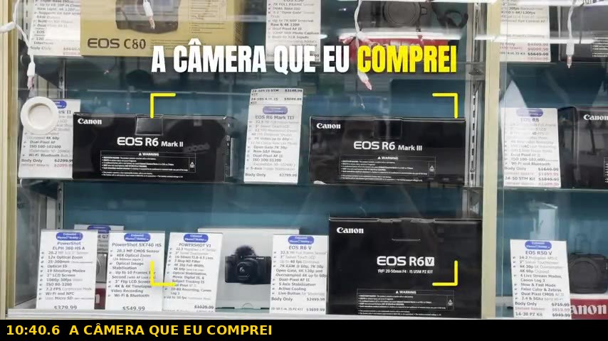

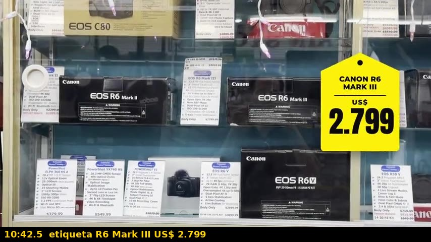

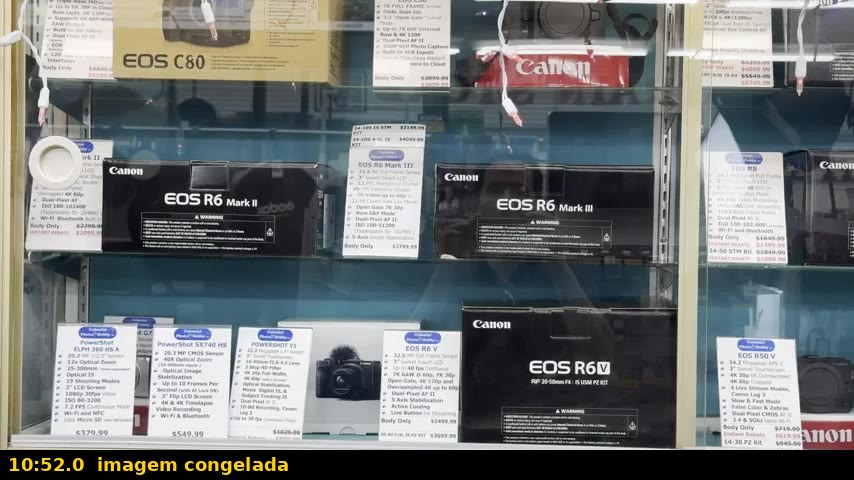


**Como achei:** Frames por segundo + `freezedetect` + palavras com tempo.

**Interpretação e dúvidas:** Provavelmente o slot foi preenchido com um quadro congelado porque os arquivos pendentes da seção 7 ainda não chegaram. Mesmo assim, como está, a promessa do gancho (0:17 a 0:22: "revela até o final desse vídeo qual câmera que eu comprei") não é cumprida.

**Sugestão:** Manter o slot F4 marcado como placeholder até chegarem a foto/vídeo da câmera e do casamento, e não deixar a vitrine congelada como se fosse a entrega final.

---

<a id="f02"></a>
### F02. 16 segundos sem fala e quase sem som, sobre imagem parada

**Tempo no vídeo:** 10:46 a 11:01  
**Severidade:** Média  
**Confiança:** Alta

**O que o plano diz:** Seção 1: "Nada de tempo morto: a cada 3 a 6 s algo muda (corte, zoom, card, animação ou b-roll)." Seção 3, F4: slot de 20 s com narração V11.

**O que o vídeo mostra:** Última palavra antes do trecho: "dólares" em 10:45,12. Próxima palavra: "Não" (pedido de inscrição) em 11:01,36. Intervalo: **16,2 s sem nenhuma palavra**. O nível de áudio cai para cerca de **-44 dB**, contra mediana de -29 dB do vídeo. A imagem está congelada nesse intervalo (ver F01).

**Evidência:** Gráfico do nível de áudio por segundo (faixa vermelha em 10:46 a 11:01).

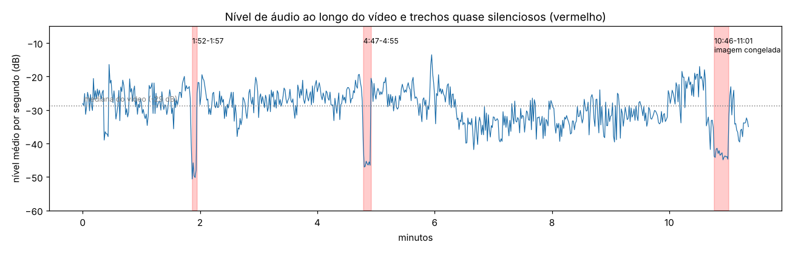

**Como achei:** Palavras com tempo + nível RMS por segundo.

**Interpretação e dúvidas:** Mesma causa de F01 (slot V11 vazio).

**Sugestão:** Resolver junto com F01.

---

<a id="f03"></a>
### F03. Ponte V10 e card C10 ausentes: a fala salta de "loja muito incrível" para "Uma marca pessoal"

**Tempo no vídeo:** 10:11 a 10:38  
**Severidade:** Média  
**Confiança:** Alta

**O que o plano diz:** Seção 3, **F2**: "V10 (slot 6 s) sobre b-roll da fachada. ESSENCIAL só a última frase ('Marca forte não morre, vira desejo.')." **F3**: "Overlays: C10 em 2060@22.99"; seção 5: C10 = "Marca forte cria fã, não cliente". Seção 4: "ESSENCIAIS V01 (gancho), V02 (abertura), V10 (frase final), V11 (revelação)".

**O que o vídeo mostra:** A fala "É uma loja muito incrível" termina em 10:11,5. A próxima palavra, "Uma" (de "Uma marca pessoal, ela começa a partir do desejo"), começa em 10:13,5. Entre elas há só um card preto de 1 s ("MAIS CEDO, NA DISNEY SPRINGS", ver F11). **A frase "Marca forte não morre, vira desejo" não aparece em nenhuma palavra da transcrição**, e o card C10 **não aparece em nenhum dos frames entre 10:13 e 10:38**.

**Evidência:** Frames: 1) fachada em 10:10 com a fala "é uma loja muito incrível"; 2) card preto em 10:12; 3) 10:30, momento em que o plano esperaria o C10: sem card.

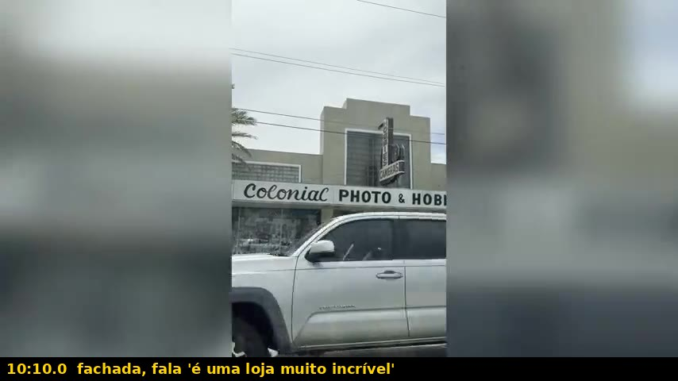

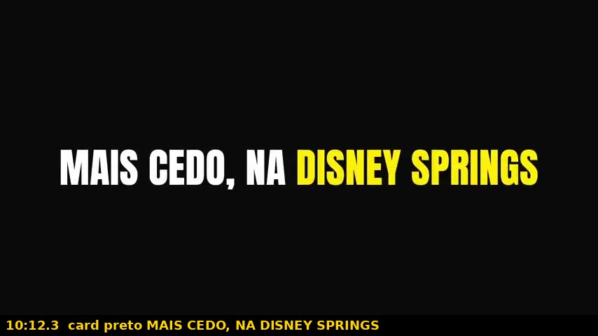

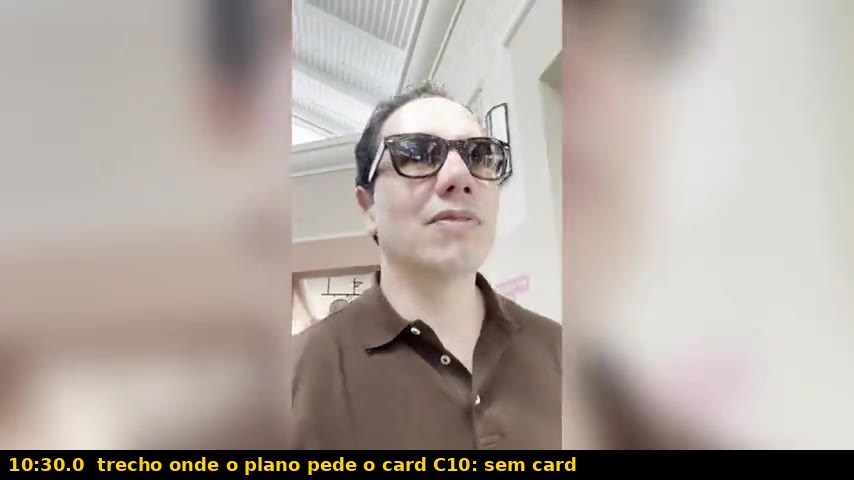

**Como achei:** Palavras com tempo + todos os frames de 10:13 a 10:38.

**Interpretação e dúvidas:** A localização exata do C10 no vídeo final é estimada (o plano dá o tempo dentro do clipe 2060, não na timeline). Por isso a confiança é alta para "V10 ausente" e para "nenhum card C10 no trecho", e não para um minuto exato.

**Sugestão:** Inserir a V10 (frase final) antes de "Uma marca pessoal" e colocar o C10 em "fã, não cliente".

---

<a id="f04"></a>
### F04. Cortes secos de áudio: um cai dentro de uma palavra

**Tempo no vídeo:** 10:37,69 (e outros)  
**Severidade:** Alta  
**Confiança:** Média

**O que o plano diz:** Seção 0: "Nenhum corte pode cair dentro de uma palavra. Tolerância de 0,15 s."

**O que o vídeo mostra:** Procurei quedas bruscas do volume da voz (queda de 15 dB ou mais em 20 ms, partindo de voz alta). Foram **6 pontos**. Na tabela, "sobra" é quanto da palavra, segundo os tempos da transcrição, ainda continuaria depois do corte:

| Tempo | Palavra | Palavra na transcrição | Sobra após o corte | Queda de volume | Leitura |
|---|---|---|---|---|---|
| 10:37,69 | "loja" ("…na porta da sua loja") | 10:37,55 a 10:38,03 | ~0,34 s (corte 0,14 s após o início) | -17 → -39 dB em 20 ms | **Provável corte dentro da palavra (forte)** |
| 8:43,16 | "C" de "USB-C" | 8:42,99 a 8:43,43 | ~0,27 s | -28 → -44 dB | Provável corte dentro da palavra |
| 9:09,52 | "ferrovia" | 9:09,09 a 9:09,63 | ~0,11 s | -26 → -41 dB | Dentro da tolerância de 0,15 s |
| 5:50,70 | "ali" ("o dentista ali") | até 5:50,76 | ~0,06 s | -28 → -44 dB | Dentro da tolerância |
| 10:11,56 | "incrível" | até 10:11,53 | 0 s | -28 → -44 dB | Corte colado no fim da palavra, sem respiro |
| 6:17,23 | "comigo" | até 6:17,22 | 0 s | -27 → -50 dB por ~20 ms | Corte no fim da palavra com **falha de áudio** de uns 20 ms |

**Evidência:** Gráficos: cada quadro mostra o nível de áudio 0,5 s antes e depois do corte (linha vermelha), com a palavra em amarelo. Em "loja" a voz está em -17 dB e despenca para -39 dB bem no meio da palavra.

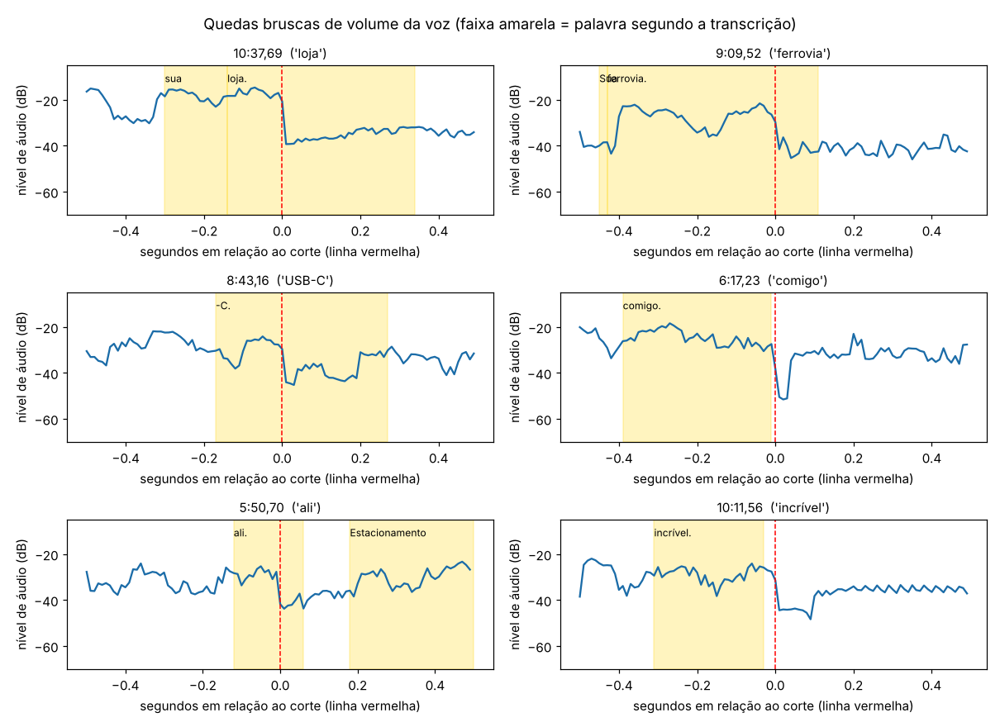

**Como achei:** Detector de queda brusca de nível (10 ms) + tempos por palavra. Complemento: 4:25,58 ("pequenininha") tem degrau de 8 dB no nível (-26 → -34 dB) em vez de queda, possivelmente emenda de dois trechos; confiança baixa.

**Interpretação e dúvidas:** O único caso forte é o de 10:37,69, e fica justamente na emenda entre o texto da mentoria e a contagem da revelação. Os tempos por palavra têm margem de erro, então **a confirmação é de ouvido**.

**Sugestão:** Ouvir 10:37 a 10:38 (palavra "loja") e 8:43 ("USB-C"). Se confirmado, estender o clipe de áudio (usar o próximo trecho ou um fade curto). Em 6:17 eliminar a falha de ~20 ms.

---

<a id="f05"></a>
### F05. Lembrete único da promessa (S11) não foi encontrado

**Tempo no vídeo:** 5:37 a 5:46  
**Severidade:** Média  
**Confiança:** Média

**O que o plano diz:** Seção 3, bloco 4, **S11**: "2089 [43.46 a 52.90] ('estamos chegando na loja... e revelo até o final qual câmera que eu comprei'). Este é o lembrete único da promessa." Seção 1: a promessa é "lembrada uma vez no meio".

**O que o vídeo mostra:** Fala nesse trecho (palavras com tempo): "Olha o semáforo como que é pendurado, bem diferente do Brasil e **estamos chegando na loja. Em breve eu mostro mais detalhes**, eu nunca falaria que esse é o caminho para uma loja de fotografia. A gente chegou aqui." (5:37 a 5:46). **Não há "revelo", "até o final" nem "câmera que eu comprei".** A promessa só aparece no gancho (0:17 a 0:22).

**Evidência:** Frames em 5:37, 5:41 e 5:45 (rua; fala do trecho acima).

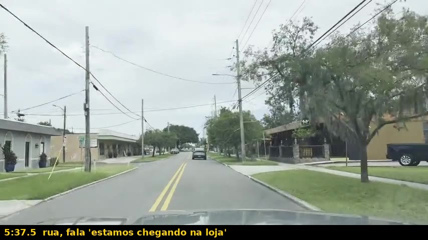

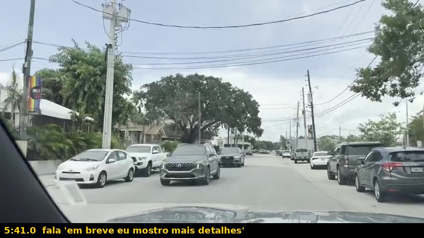

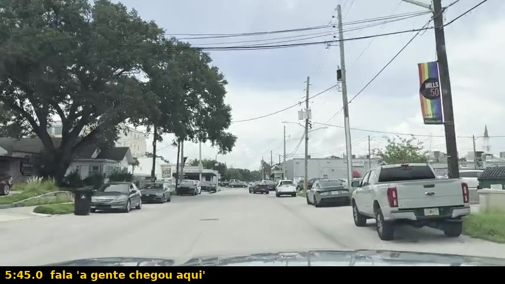

**Como achei:** Palavras com tempo, procurando "revelo", "até o final", "câmera que eu comprei".

**Interpretação e dúvidas:** A frase entre aspas no plano pode ser paráfrase do editor, e o reconhecimento de voz pode ter errado. **Confirmar de ouvido 5:37 a 5:46.**

**Sugestão:** Se realmente ausente, inserir a frase do 2089 [43.46 a 52.90].

---

<a id="f06"></a>
### F06. Preço da Canon EOS R1: card mostra US$ 6.799, o plano e a fala dizem US$ 7.000

**Tempo no vídeo:** 0:03 e 8:30  
**Severidade:** Média  
**Confiança:** Alta

**O que o plano diz:** Seção 3, **G1**: "2099 [17.96 a 24.60] etiqueta da R1 US$ 7.000". Seção 5, **C16**: "Canon EOS R1 US$ 7.000". Seção 3, T4: "A3 R1 em 19.46 a 24.80".

**O que o vídeo mostra:** Etiqueta amarela "CANON EOS R1 US$ 6.799" aparece em **0:03 a 0:05** (gancho) e em **8:30 a 8:32** (tour). Na fala, em 8:30 a 8:32, o apresentador diz "R1, 7.000 dólares" (palavras "7 .000 dólares" em 8:31,6 a 8:32,5).

**Evidência:** Frames: 1) gancho; 2) tour. A fala diz 7.000 enquanto a etiqueta mostra 6.799.

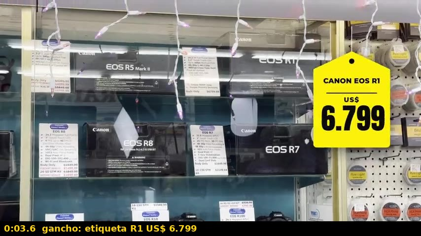

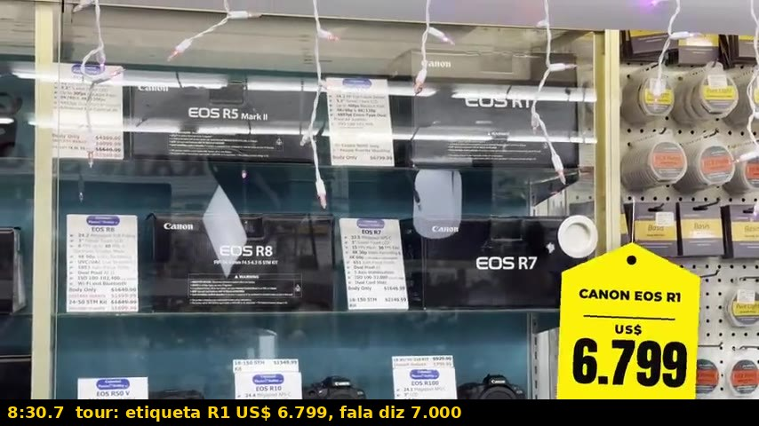

**Como achei:** Leitura da etiqueta nos frames + palavras com tempo.

**Interpretação e dúvidas:** O preço de prateleira pode ser mesmo US$ 6.799 e o apresentador arredondou para 7.000, ou o plano arredondou. Só o clipe original 2099 (17.96 a 24.60) resolve.

**Sugestão:** Conferir a etiqueta no clipe original e usar o mesmo valor no card, no plano e (se necessário) na fala.

---

<a id="f07"></a>
### F07. Godox AD600: card US$ 900, plano diz US$ 800, e o preço não é dito

**Tempo no vídeo:** 7:14 a 7:16  
**Severidade:** Média  
**Confiança:** Alta

**O que o plano diz:** Seção 3, **T1**: "[100.50 a 108.04] (AD600, US$ 800)" e "A3 AD600 em 101.20". Seção 5, **C16**: "Godox AD600 US$ 800".

**O que o vídeo mostra:** Etiqueta "GODOX AD600 US$ 900" de 7:14 a 7:16. A fala nesse ponto é "A B600 [= AD600]. Várias câmeras. Para revelação…" (7:14,6 a 7:19). **Nenhum preço é falado.**

**Evidência:** Frame da etiqueta em 7:15.

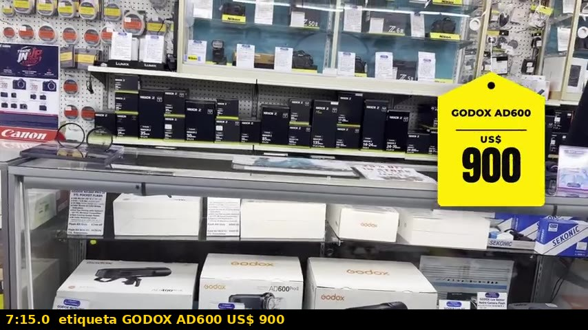

**Como achei:** Etiqueta nos frames + palavras com tempo.

**Interpretação e dúvidas:** O corte do editor pode ter tirado a frase do preço que o plano cita ("US$ 800"), e o valor do card veio de outra fonte. Não há como saber qual é o certo sem o clipe 2096.

**Sugestão:** Conferir no clipe 2096 [100.50 a 108.04].

---

<a id="f08"></a>
### F08. Canon R5 Mark II: card US$ 5.349, plano e fala dizem 5 mil

**Tempo no vídeo:** 3:40 a 3:42  
**Severidade:** Baixa  
**Confiança:** Alta

**O que o plano diz:** Seção 3, **B7**: "A3 (Canon, US$ 5.000) em 169.47". Seção 5, **C16**: "Canon (modelo a confirmar no 1995) US$ 5.000".

**O que o vídeo mostra:** Etiqueta "CANON R5 MARK II + LENTE US$ 5.349" em 3:40 a 3:42. A fala: "Cinco mil dólares com a lente" (3:40,2 a 3:42,2). O display eletrônico da prateleira no frame seguinte mostra "$5,349.00".

**Evidência:** Frame da etiqueta em 3:40.

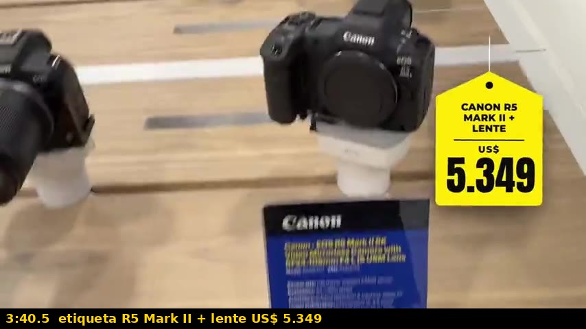

**Como achei:** Etiqueta e display no frame + palavras com tempo.

**Interpretação e dúvidas:** O editor confirmou o modelo (o plano pedia "a confirmar") e usou o preço da prateleira. O card está mais exato que o plano; a divergência é só com a fala e com o texto do plano.

**Sugestão:** Atualizar o plano para US$ 5.349 ou manter o arredondamento e avisar no card ("≈ US$ 5.000").

---

<a id="f09"></a>
### F09. Card da família: grafia "ANDREZA" e dois cards fundidos em um

**Tempo no vídeo:** 2:03 a 2:06  
**Severidade:** Média  
**Confiança:** Média

**O que o plano diz:** Seção 3, **B7**: "C2a 'Andresa, a esposa' na palavra 'Andresa' (~34 s); C2b 'Francisco, o filho' em 61.97". Seção 5: "C2a 'Andresa, a esposa' / C2b 'Francisco, o filho'".

**O que o vídeo mostra:** Um único card: "**ANDREZA**, A ESPOSA · **FRANCISCO**, O FILHO" de 2:03 a 2:06, sincronizado com a fala "A Andresa está ali com o Francisco" (2:03,63 a 2:05,03), sobre a imagem do carro na garagem. Duas diferenças: (1) grafia com Z, o plano usa S; (2) os dois cards viraram um só e foram para a chegada à Best Buy, e não ficaram dentro do clipe 1995, nas menções ("olha a câmera que a Andresa quer", 3:02,5).

**Evidência:** Frame do card em 2:04.

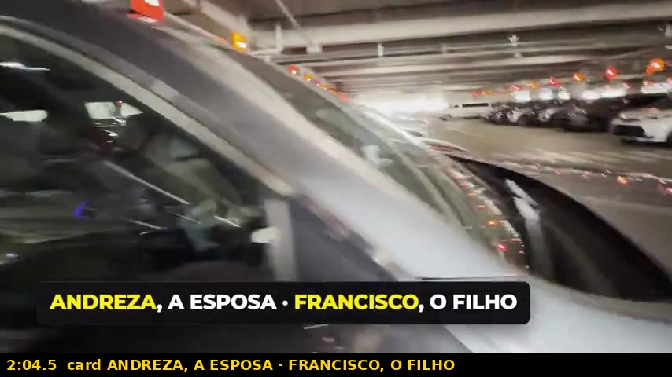

**Como achei:** Frames + palavras com tempo.

**Interpretação e dúvidas:** O áudio não decide a grafia do nome. A decisão é do Cristian.

**Sugestão:** Confirmar a grafia correta e decidir se mantém o card fundido (funciona na chegada) ou separa como no plano.

---

<a id="f10"></a>
### F10. Card "DOIS DIAS ANTES · BEST BUY": a informação "dois dias" não está no plano

**Tempo no vídeo:** 1:51 a 1:52  
**Severidade:** Média  
**Confiança:** Alta

**O que o plano diz:** Seção 3, bloco 3: "Card de transição de 1,5 s: 'ANTES: BEST BUY'." Seção 3, S08: "NÃO usar 2089 [11.04 a 31.28] (data errada, '10 de agosto', e meta-conversa)".

**O que o vídeo mostra:** Card preto "DOIS DIAS ANTES · BEST BUY" com 1,3 a 1,5 s de duração (de 1:50,67 a 1:52,0). A duração está de acordo com o plano; o texto, não.

**Evidência:** Frame do card em 1:51.

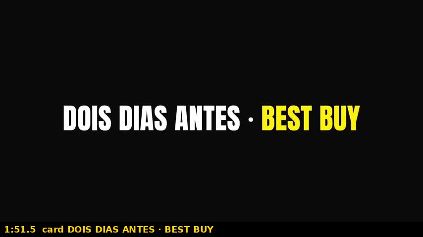

**Como achei:** Frames em 6 fps para medir a duração.

**Interpretação e dúvidas:** O plano diz só "ANTES". "Dois dias" é um dado novo que eu não consigo confirmar por nada no vídeo ou no plano, e o plano já avisa que a data falada no 2089 estava errada.

**Sugestão:** Voltar ao texto do plano ("ANTES: BEST BUY") ou confirmar o intervalo real com o Cristian.

---

<a id="f11"></a>
### F11. Card "MAIS CEDO, NA DISNEY SPRINGS" não está no plano

**Tempo no vídeo:** 10:12 a 10:13  
**Severidade:** Média  
**Confiança:** Média

**O que o plano diz:** Seção 3, **F3**: "…com imagem de CFE3D1B3 [0.00 a 56.00] em video-only (Disney Springs)." Nenhum card de transição é previsto para essa entrada.

**O que o vídeo mostra:** Card preto "MAIS CEDO, NA DISNEY SPRINGS" por cerca de 1 s (10:12 a 10:13), logo antes das imagens do Disney Springs.

**Evidência:** Frame em 10:12.


**Como achei:** Frames.

**Interpretação e dúvidas:** Ajuda a explicar a troca de cenário, mas afirma uma ordem no tempo ("mais cedo") que não consigo confirmar. As imagens do Disney Springs têm luz de dia e o resto do vídeo é nublado, o que sugere dias diferentes, mas isso é palpite.

**Sugestão:** Confirmar com o Cristian se foi no mesmo dia; se não, trocar por um texto neutro ("DISNEY SPRINGS").

---

<a id="f12"></a>
### F12. Legenda "MESMO PREÇO DA B&H" sem atribuição

**Tempo no vídeo:** 9:35 a 9:37  
**Severidade:** Baixa  
**Confiança:** Alta

**O que o plano diz:** Seção 0: "Afirmações fortes do Cristian (ex.: 'Osmo em falta') entram em card com atribuição suave ('nesta loja'), nunca como fato geral." (A regra é dada para outro exemplo; aqui é aplicada por analogia.)

**O que o vídeo mostra:** Legenda "MESMO PREÇO DA B&H" de 9:35 a 9:37, sobre o DJI Mic 3, repetindo a fala "Mesmo preço da BH" (9:35,9 a 9:37,4). Não diz de quem é a afirmação nem qual produto.

**Evidência:** Frame em 9:35.

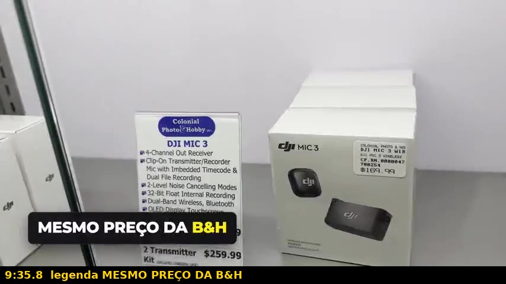

**Como achei:** Frames + palavras com tempo.

**Interpretação e dúvidas:** É uma comparação de preço entre duas lojas, dita de forma geral. A regra do plano é sobre afirmações fortes.

**Sugestão:** Mudar para "Nesta loja: mesmo preço da B&H" ou "Segundo ele, mesmo preço da B&H".

---

<a id="f13"></a>
### F13. Card "LOJA 1: HARMON PHOTO · SÓ USADOS": cita a loja e usa "SÓ", a fala diz "a maioria"

**Tempo no vídeo:** 0:53 a 0:55  
**Severidade:** Baixa  
**Confiança:** Média

**O que o plano diz:** Seção 5, **A9a**: "'LOJA 1 · SÓ USADO' marcada, as outras duas acesas fracas". Seção 0 (afirmações fortes). Nenhum card previsto com o nome da Loja 1.

**O que o vídeo mostra:** Card "LOJA 1: HARMON PHOTO · SÓ USADOS" em 0:53 a 0:55. A fala: "…que tem bons equipamentos usados, mas é uma loja pequena… a maioria de coisas usadas" (0:35 a 0:48). A placa na vitrine diz "WE BUY USED CAMERAS" e o nome "HARMON PHOTO" aparece na fachada.

**Evidência:** Frames: 1) o card; 2) a placa "WE BUY USED CAMERAS".

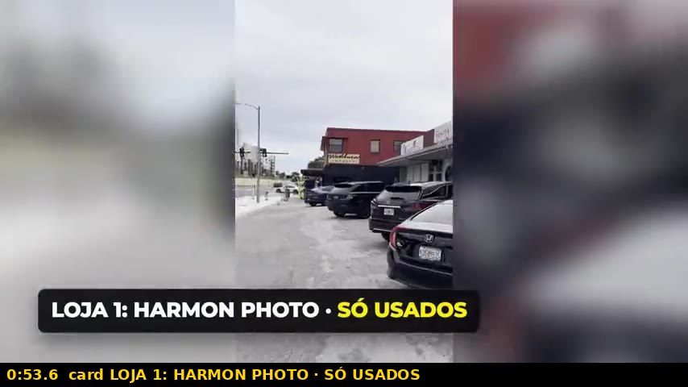

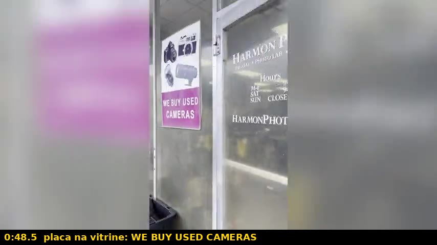

**Como achei:** Frames + palavras com tempo.

**Interpretação e dúvidas:** O nome está certo na fachada. O problema é "SÓ USADOS" (absoluto) contra "a maioria" (fala). O plano mesmo escreve "SÓ USADO" no tracker A9a, então o editor seguiu o plano; o risco é o nome de uma loja real ligado a uma afirmação absoluta.

**Sugestão:** Trocar por "MAIORIA USADOS" ou tirar o nome da loja.

---

<a id="f14"></a>
### F14. Etiqueta "KODAK DIGITAL US$ 69" aparece uns 3 s antes de a fala dizer o preço

**Tempo no vídeo:** 4:32 a 4:34  
**Severidade:** Média  
**Confiança:** Alta

**O que o plano diz:** Seção 3, **B9**: "Overlays: A3 Kodak em 46.28; C9 em 61.54 a 64.48". Seção 1: cada card "ajuda a entender".

**O que o vídeo mostra:** Etiqueta na tela de 4:32 a 4:34. A fala "Kodak" é em 4:30,9; **"69 dólares" só em 4:36,8 a 4:37,3**. No momento em que o preço é dito a etiqueta já saiu.

**Evidência:** Frame 1: etiqueta na tela (4:32,8). Frame 2: no momento do preço falado (4:37,2) já não há etiqueta.

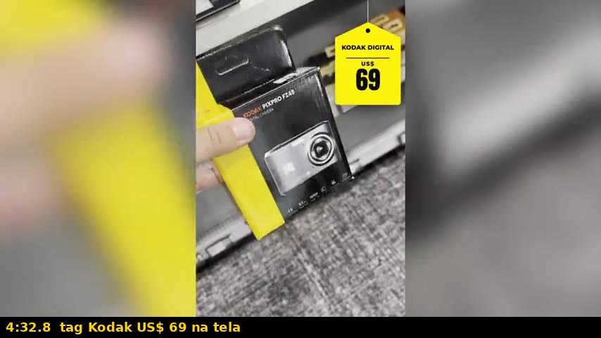

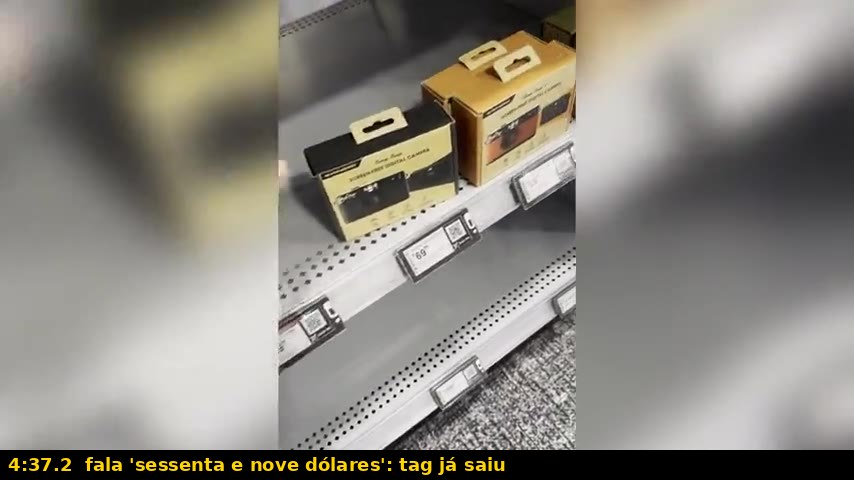

**Como achei:** Frames + palavras com tempo.

**Interpretação e dúvidas:** O tempo do plano é relativo ao clipe, então não dá para checar o plano em segundos; o erro é de sincronia entre card e fala.

**Sugestão:** Mover a etiqueta para 4:36,5 a 4:38,5.

---

<a id="f15"></a>
### F15. Etiqueta "MODIFICADOR DE FLASH US$ 60" sai quando a fala começa a dizer "60 dólares"

**Tempo no vídeo:** 9:24 a 9:27  
**Severidade:** Média  
**Confiança:** Alta

**O que o plano diz:** Seção 1: cards ajudam a entender; seção 0: preços aparecem em "US$". (O plano não prevê este card; ele foi acrescentado pelo editor.)

**O que o vídeo mostra:** Etiqueta na tela de 9:24 a 9:27. A fala "Valor, 60 dólares" é em 9:26,6 a 9:28,4 ("60" em 9:27,4). A etiqueta aparece uns 2,5 s antes do preço e sai antes de o preço terminar.

**Evidência:** Frame 1: etiqueta na tela (9:25,5). Frame 2: voz diz "60 dólares" (9:27,9) e a etiqueta já saiu.

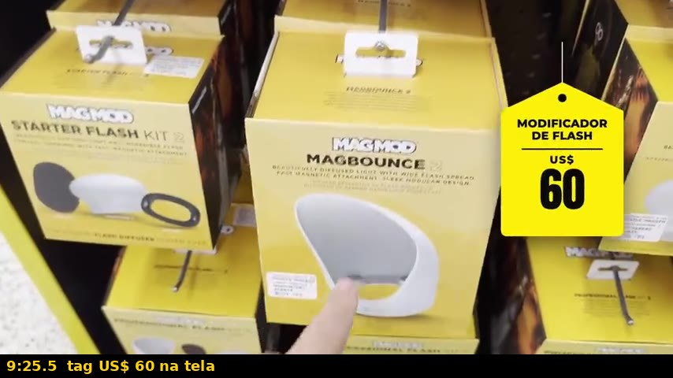

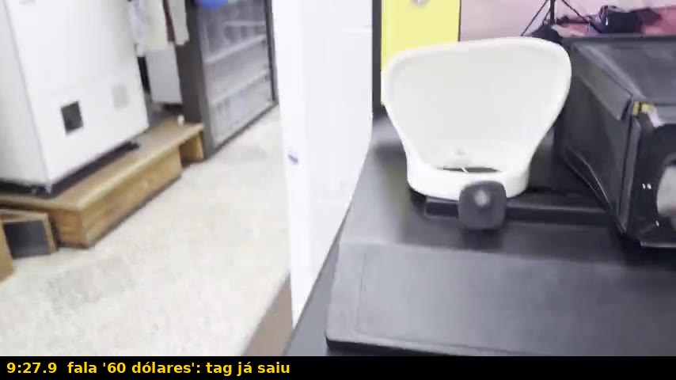

**Como achei:** Frames + palavras com tempo.

**Interpretação e dúvidas:** Card extra (não está no plano) mas útil; só precisa ser deslocado.

**Sugestão:** Mover para 9:27 a 9:29.

---

<a id="f16"></a>
### F16. Citação "…mas gostaria de ter" sai antes de a frase ser dita

**Tempo no vídeo:** 7:57 a 8:02  
**Severidade:** Baixa  
**Confiança:** Alta

**O que o plano diz:** Seção 5, **C17**: "Você vê tudo o que precisa e o que não precisa, mas gostaria de ter" (citação do 2097@70.87), no tempo "2097@70.87 a 74.00".

**O que o vídeo mostra:** A legenda fica de 7:57 a 8:01. A fala "Mas você gostaria de ter" vem em **8:01,7 a 8:03,2**. A parte em amarelo da legenda ("gostaria de ter") já saiu quando é falada.

**Evidência:** Frame 1: legenda na tela (8:00). Frame 2: voz diz "gostaria de ter" (8:02) e a legenda já saiu.

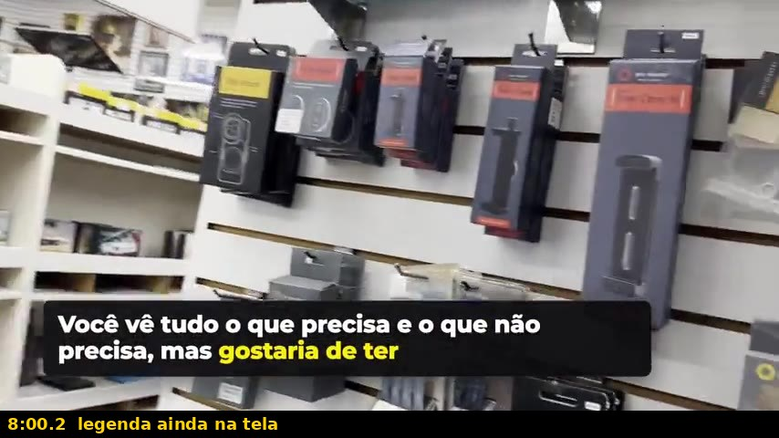

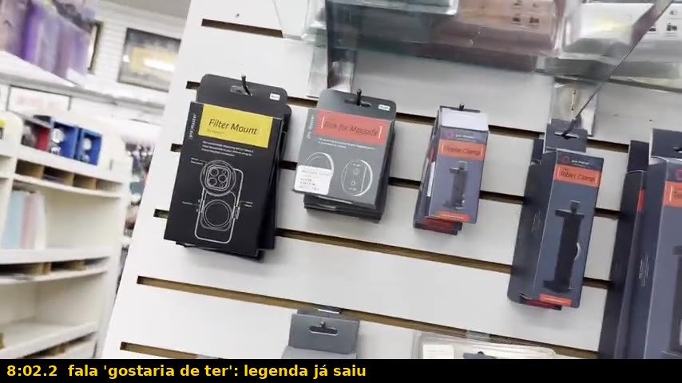

**Como achei:** Frames + palavras com tempo.

**Interpretação e dúvidas:** O plano prevê 3,1 s para o card; aqui são 4 s, mas terminam 1,5 s antes da frase acabar.

**Sugestão:** Estender até 8:03.

---

<a id="f17"></a>
### F17. Mapa do trajeto mostra "7 MIN" cerca de 1 s depois de a fala dizer "7 minutos"

**Tempo no vídeo:** 1:14 a 1:18  
**Severidade:** Baixa  
**Confiança:** Alta

**O que o plano diz:** Seção 3, **S04**: "Overlay: A6 em 47.70 a 51.70 (palavra '7 minutos')".

**O que o vídeo mostra:** A fala "estamos a 7 minutos de lá" tem "7" em 1:15,7 e "minutos" em 1:15,8. O mapa conta 0 → 4 → 6 → **7 MIN**: o valor "6 MIN" está na tela em 1:15,9 e "7 MIN" só em 1:17,5.

**Evidência:** Frame 1: fala "7 minutos" com o mapa em 6 MIN. Frame 2: mapa em 7 MIN, 1,6 s depois.

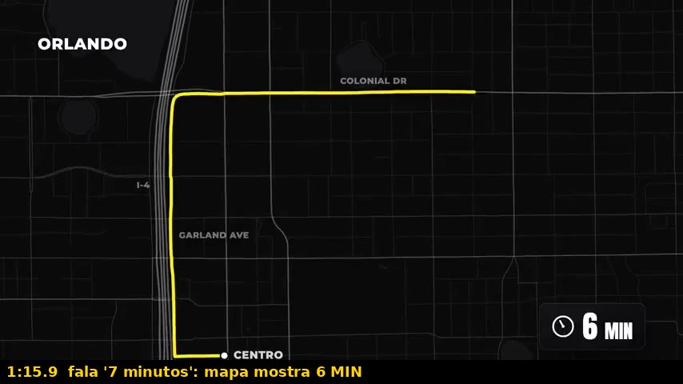

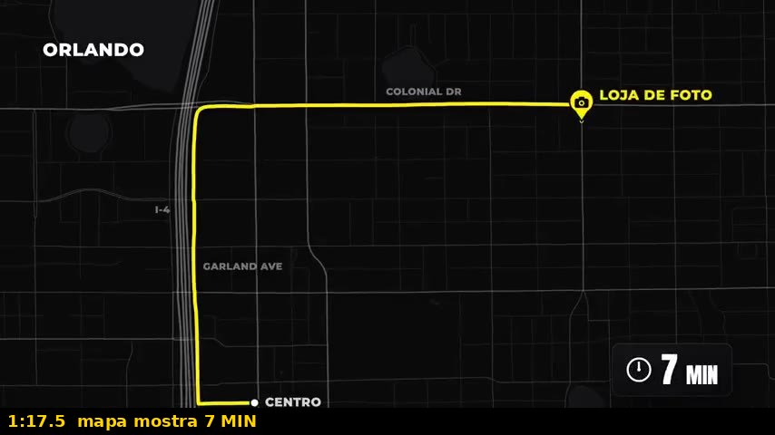

**Como achei:** Frames + palavras com tempo.

**Interpretação e dúvidas:** Defasagem pequena e que não confunde; é a animação aprovada reaproveitada.

**Sugestão:** Adiantar a animação em ~1,5 s ou aceitar.

---

<a id="f18"></a>
### F18. Possível desencontro de boca no começo do gancho

**Tempo no vídeo:** 0:00 a 0:03  
**Severidade:** Baixa  
**Confiança:** Baixa

**O que o plano diz:** Seção 3, **G1**: "cortes de 2 a 3 s, video-only, sobre a narração V01" ("video-only = só imagem, sem o áudio original"). A lista de clipes do G1 tem 2099, 2102, 1999 e 2093.

**O que o vídeo mostra:** Os 3 primeiros segundos mostram o apresentador no carro **com a boca em movimento e gesticulando**, com a narração do gancho tocando por cima ("E hoje nós vamos encontrar uma raridade…"). Esse clipe não faz parte da lista do G1. Só depois (0:03) entram as etiquetas da R1 (2099).

**Evidência:** Frames em 0,4 s, 1,4 s e 2,4 s.

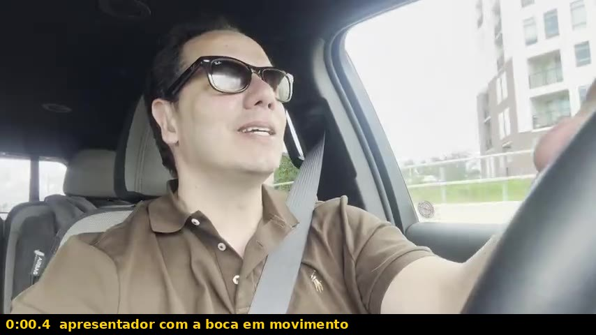

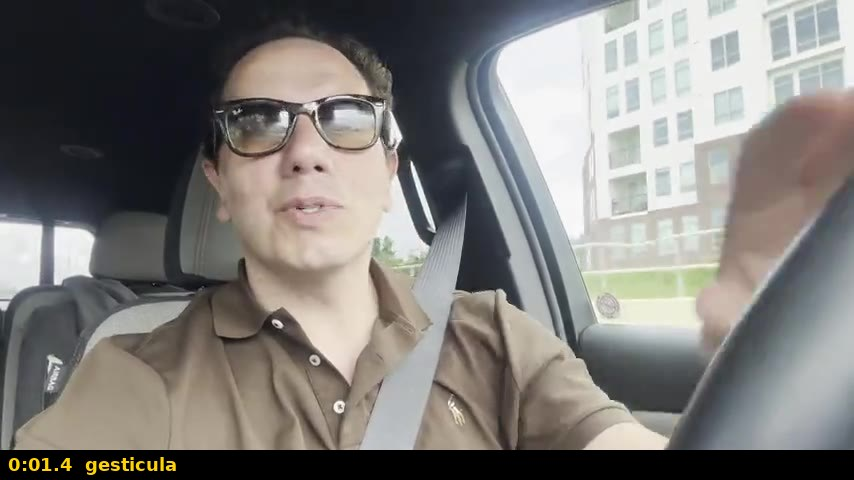

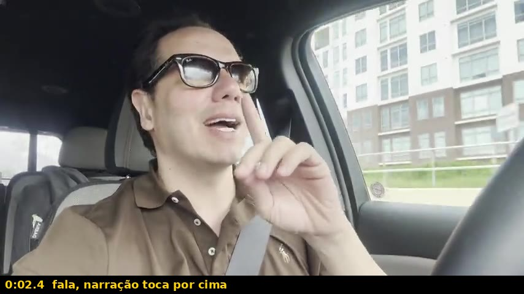

**Como achei:** Frames por segundo.

**Interpretação e dúvidas:** Se a voz que toca é a narração V01 (gravada depois) e o apresentador aparece falando, a boca não vai bater. Se a voz for a dele mesmo, está certo. Não consigo decidir pelo áudio.

**Sugestão:** Ouvir os 3 primeiros segundos e, se for narração, trocar por um dos clipes do G1.

---

<a id="f19"></a>
### F19. Gancho sem o clipe da Kodak

**Tempo no vídeo:** 0:00 a 0:16  
**Severidade:** Baixa  
**Confiança:** Alta

**O que o plano diz:** Seção 3, **G1**: 4 cortes de 2 a 3 s: 2099 etiqueta R1; 2102 R5C usada; **1999 Kodak US$ 69**; 2093 fachada.

**O que o vídeo mostra:** O gancho mostra: apresentador (0:00 a 0:03); vitrine com etiqueta R1 (0:03 a 0:05); câmera de cinema TILTA/Canon (0:05 a 0:06, compatível com a R5C); prateleira de caixas (0:06 a 0:08); câmeras de cinema (0:08 a 0:10); mural de fotos antigas na vitrine (0:10 a 0:12); mapa dos EUA (0:12 a 0:16). Não há clipe da Kodak. O mapa dos EUA (cuja animação o plano põe em S02, em 2088@19.18) entra aqui, ao final do gancho.

**Evidência:** Ver tabela segundo a segundo, 0:00 a 0:16.

**Como achei:** Frames por segundo.

**Interpretação e dúvidas:** Escolha editorial; só é problema se o plano for rígido.

**Sugestão:** Confirmar se a Kodak deve voltar ao gancho.

---

<a id="f20"></a>
### F20. Ordem e duração das animações de mapa/tracker diferem do plano

**Tempo no vídeo:** 0:12 a 1:18  
**Severidade:** Baixa  
**Confiança:** Alta

**O que o plano diz:** Seção 3: **S01** "A1 (5 s, mapa Brasil -> Orlando)" primeiro; **S02** "A2 em 19.18 a 23.18" durante o 2088; **S05** "A9a (tracker, 4 s) entra logo após 'bom!'". Seção 5: "A9a e A9b (tracker…, 4 s cada)".

**O que o vídeo mostra:** Mapa dos EUA (B&H · ADORAMA, ≈1.500 km) em 0:12 a 0:16, **antes** do mapa Rio → Orlando (A1, ≈7.000 km) em 0:22 a 0:27. Tracker A9a em 1:08 a 1:12, **antes** do mapa de 7 minutos (A6, 1:14) e antes de "vai ser um bom!" (1:25 a 1:26). Tracker A9b em 4:48 a 4:55 (**7 s**, contra 4 s no plano).

**Evidência:** Frames: mapa dos EUA em 0:12 e Rio → Orlando em 0:24.

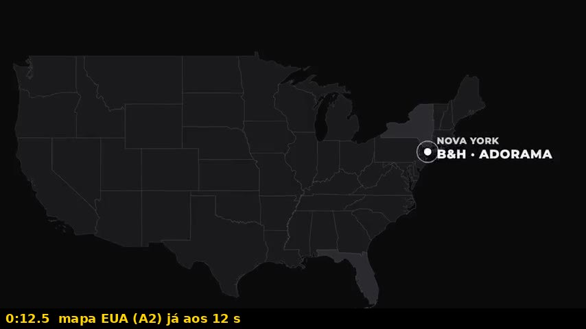

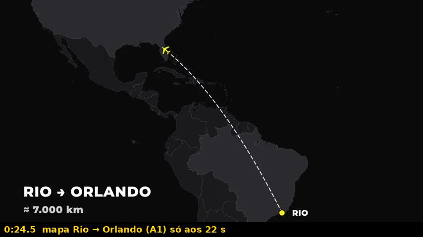

**Como achei:** Frames por segundo e transcrição para localizar "bom".

**Interpretação e dúvidas:** O plano dá tempos relativos aos clipes; as ordens e durações acima foram medidas na timeline final.

**Sugestão:** Alinhar com o plano ou aceitar a mudança.

---

<a id="f21"></a>
### F21. Duas pausas quase silenciosas sobre imagem sem movimento

**Tempo no vídeo:** 4:47 a 4:55 e 1:52 a 1:57  
**Severidade:** Média  
**Confiança:** Alta

**O que o plano diz:** Seção 1: "Nada de tempo morto… Trechos sem fala: jump cut ou 2x." Seção 3, bloco 3: "Card de transição de 1,5 s… Narração V04 (opcional, slot 5 s) sobre b-roll." Seção 5: tracker "4 s".

**O que o vídeo mostra:** **1:52 a 1:57**: 5 s de b-roll do aeroporto em silêncio (cerca de -50 dB) após o card. A fala só começa em 1:57,45 ("E assim começamos o nosso tour…"). **4:47 a 4:55**: o card "DE VOLTA AO CAMINHO" (1,4 s) e depois 7 s de tracker sobre uma cena quase parada (McDonald's, vertical), sem nenhuma palavra de 4:46,7 a 4:55,4 (8,7 s) e áudio a -46 dB.

**Evidência:** Gráfico de nível (faixas vermelhas) e frames do tracker no início e 5 s depois: a cena quase não muda.

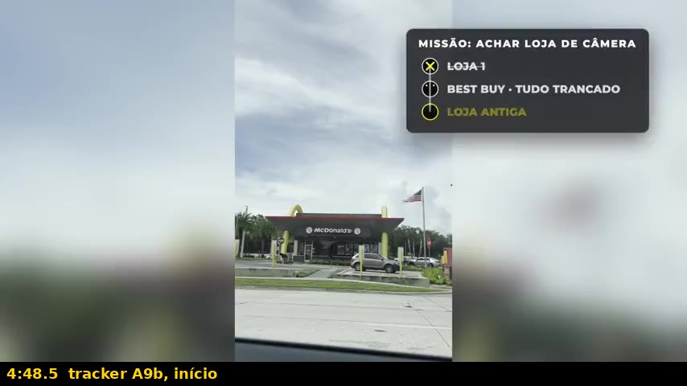

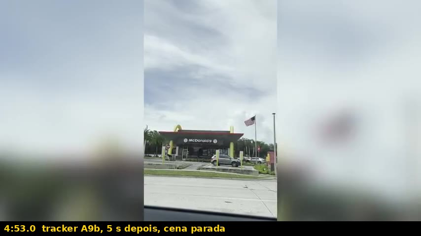


**Como achei:** Nível de áudio por segundo + lacunas entre palavras.

**Interpretação e dúvidas:** Pode ser a V04 opcional que ainda não entrou (1:52) e uma pausa estilística (4:48). Mesmo assim contradiz a regra de ritmo do plano.

**Sugestão:** Encurtar o tracker para 4 s e/ou colocar música ou b-roll em movimento.

---

<a id="f22"></a>
### F22. Etiqueta da R6 Mark III ausente no clipe 2099 (só aparece na revelação)

**Tempo no vídeo:** 8:25 a 8:32  
**Severidade:** Baixa  
**Confiança:** Média

**O que o plano diz:** Seção 3, **T4**: "A3 R6 Mark II em 3.72 a 6.66; A3 R6 Mark III em 7.06 a 10.56 (conferir no frame qual etiqueta é qual); A3 R1 em 19.46 a 24.80." Seção 5, C16: "R6 Mark II US$ 2.099 · R6 Mark III US$ 2.799".

**O que o vídeo mostra:** Etiqueta R6 Mark II US$ 2.099 em 8:25 a 8:27 e etiqueta R1 em 8:30 a 8:32. **Entre elas (8:27 a 8:30) a vitrine aparece sem etiqueta da R6 Mark III**; a etiqueta US$ 2.799 só vem na revelação (10:42).

**Evidência:** Frames: 1) tag R6 Mark II; 2) vitrine sem tag; 3) tag R1.

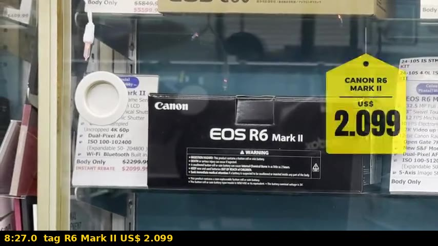

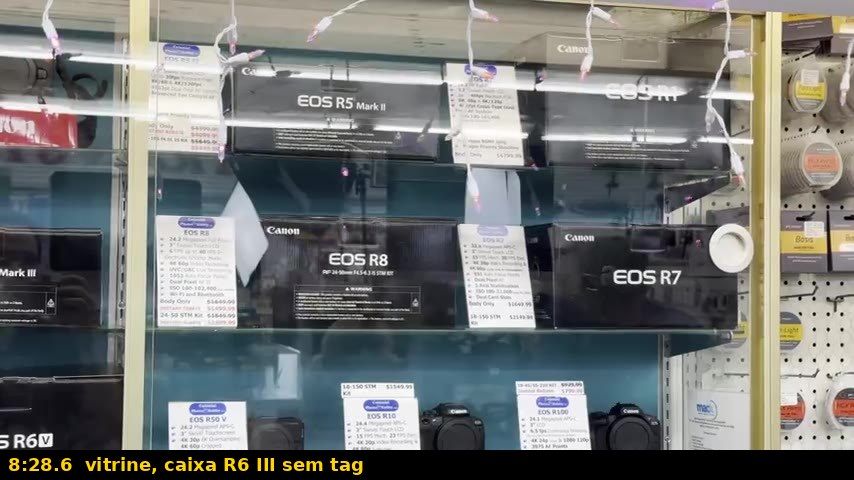

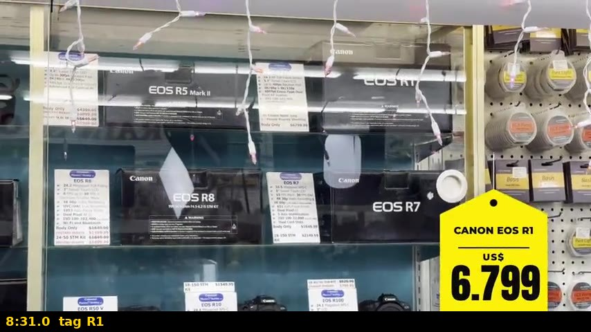

**Como achei:** Frames por segundo.

**Interpretação e dúvidas:** Pode ser decisão consciente: guardar o preço da Mark III para a revelação.

**Sugestão:** Confirmar a intenção.

---

<a id="f23"></a>
### F23. Etiqueta da sapata (US$ 7) não aparece

**Tempo no vídeo:** 7:37 a 7:44  
**Severidade:** Baixa  
**Confiança:** Média

**O que o plano diz:** Seção 3, **T1**: "[186.10 a 195.79] + [199.25 a 201.89] (suporte de sapata, US$ 7)" e "A3 sapata em 199.75 a 202.00". Seção 5, C16: "sapata US$ 7".

**O que o vídeo mostra:** Nos frames de 7:37 a 7:44 (a mão mostra "Flash Stand" e "Cold Shoe Mount", e a fala diz "Suporte de sapata para todos os lados, que legal") **não há etiqueta de preço**. Não vi nenhuma etiqueta "US$ 7" em todo o vídeo.

**Evidência:** Tabela segundo a segundo, 7:37 a 7:44.

**Como achei:** Frames por segundo.

**Interpretação e dúvidas:** Cut e preço podem ter sido deixados de fora por escolha.

**Sugestão:** Se o preço for relevante, adicionar a etiqueta.

---

<a id="f24"></a>
### F24. Card C15 "Osmo em falta nesta loja" não aparece (e a imagem não o apoia claramente)

**Tempo no vídeo:** 9:49 a 9:56  
**Severidade:** Baixa  
**Confiança:** Média

**O que o plano diz:** Seção 5: "C15 'Osmo em falta nesta loja'". Seção 3, **T7**: "C15 em 35.05 a 38.00". Seção 0: afirmações fortes entram com atribuição suave.

**O que o vídeo mostra:** Não há card C15. Nos frames de 9:49 a 9:52 aparece a etiqueta "DJI OSMO COMBO US$ 550" sobre uma caixa de Osmo Pocket 3 em prateleira, ou seja, **estoque visível**; e a fala diz "A Osmo 3 combo, 550 dólares".

**Evidência:** Frame da Osmo em 9:49.

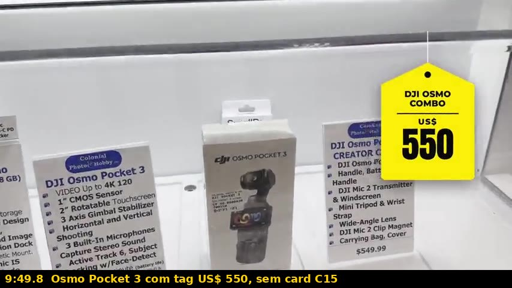

**Como achei:** Frames + palavras.

**Interpretação e dúvidas:** A ausência pode ser uma boa decisão, porque a imagem mostra o produto à venda. Há placas do "Osmo Nano" ao lado sem caixa, o que pode significar falta só desse modelo; não dá para afirmar.

**Sugestão:** Decidir com o Cristian: manter fora (recomendo) ou adicionar com texto específico ("Osmo Nano em falta") se for o caso.

---

## O que está de acordo com o plano

- **Estrutura em blocos.** A ordem do plano foi seguida: gancho, abertura, ponte, Best Buy, de volta ao caminho, chegada, tour, fechamento.
- **Duração dos cards de transição.** "DOIS DIAS ANTES · BEST BUY" dura ~1,3 s e "DE VOLTA AO CAMINHO" ~1,4 s (plano: 1,5 s). "A ÚNICA QUE SOBREVIVEU" dura ~3 s (plano: 3 s).
- **Cards alinhados com a fala.** US$ 30 do tripé (C11, 1:01 a 1:04; fala "30 dólares" em 1:01,3); OPEN BOX (C6, 2:20); TIME CANON (C7, 3:24); "Meu kit" (C8, 3:51); A4 "MESMA LOJA, OLHA A DIFERENÇA" (4:11); legenda "50 fotos…" (4:43); bicicleta elétrica (C12, 5:02, fala "bicicleta" em 5:02,3); tendência de filme (C13, 7:46); "TODO MUNDO SE REINVENTA" (C18, 8:48); trens e Lego (C14, 9:20); R6 Mark II US$ 2.099 (8:25 a 8:27, fala 8:25,9); R5C US$ 2.750 (9:39); RED US$ 4.500 (9:46); Osmo US$ 550 (9:49); "DESEJO", "POSICIONAMENTO" e "FILA NA PORTA" nas palavras certas.
- **Nome da loja confirmado.** O lower-third "COLONIAL PHOTO & HOBBY · LOJA ANTIGA DE ORLANDO" entra em 6:07 (A7) e a fachada confirma o nome, como o plano exigia ("o nome da loja só entra depois de confirmado no frame").
- **Etiqueta R5C.** O texto está correto ("CANON R5C USADA US$ 2.750"). Ampliando o frame em 9:39 lê-se "R5C"; a leitura "RSC" em baixa resolução era engano meu.
- **Fala completa.** Primeira palavra em 0:00,11, última em 11:07,20. Nenhuma tela preta; nenhum trecho com silêncio acima de 1,2 s a -40 dB.
- **Final com reserva de tela final.** Depois do pedido de inscrição (termina 11:07,20) há 15 s de b-roll do Disney Springs (até 11:22), compatível com a reserva de 15 s de end screen do plano (F4).

## Situação de cada bloco do plano

| Plano | Observado no vídeo | Situação |
|---|---|---|
| G1 Gancho (0:00 a 0:16) | Apresentador, R1, câmeras de cinema, vitrines, mural, mapa dos EUA | Presente, com diferenças (F18, F19) |
| S01 A1 Rio → Orlando | 0:22 a 0:27, depois do mapa dos EUA | Presente; ordem diferente (F20) |
| S02 a S04 Abertura com o apresentador e Harmon Photo | 0:27 a 1:26; cards C11 ✓, A9a, A6 | Presente (F13, F17, F20) |
| S06 a S08 Ponte para a Best Buy | 1:26 a 1:50 (trilho, Tesla, "Best Buy") | Presente |
| Card "ANTES: BEST BUY" | 1:51 com texto diferente | Presente com texto diferente (F10) |
| B1 a B6 (1993/1994) | 1:53 a 2:55; C6 OPEN BOX ✓ 2:20 | Presente |
| B7 (1995) com A3, C2a, C2b, C7 | 2:55 a 3:50; C7 ✓; A3 Canon US$ 5.349; C2 fundido em 2:03 | Presente com diferenças (F08, F09) |
| B8 (1996) com C8, A4 | 3:51 a 4:20; C8 ✓, A4 ✓, legenda Fujifilm X-M5 extra | Presente |
| B9 (1999 Kodak) com A3 e C9 | 4:28 a 4:47; A3 ✓; C9 virou legenda "50 fotos e você não vê a foto" | Presente com diferenças (F14) |
| Card "DE VOLTA AO CAMINHO" + S10 | 4:47 a 5:30; C12 ✓ | Presente (F21) |
| S11 Lembrete da promessa | 5:30 a 5:45 | Não encontrado (F05) |
| S12 a S16 Chegada à loja | 5:45 a 6:20; A9b ✓ 5:58; A7 ✓ 6:07 | Presente |
| T1 a T7 Tour (A3 AD600, sapata, R6 Mark II/III, R1, R5C, RED, Osmo; C13, C14, C17, C18) | 6:20 a 9:58 | Presente, com falhas de preço, sincronia e itens ausentes (F06, F07, F15, F16, F22, F23, F24) |
| F1 "Acabei de sair… a única que sobreviveu" + A10 | 9:59 a 10:12; A10 ✓ | Presente |
| F2 V10 | Frase final ausente | Ausente (F03) |
| F3 Disney Springs + A5a/b/c | 10:13 a 10:38; A5a/b/c ✓; C10 ✗ | Presente com falhas (F03, F11) |
| F4 V11 + A8 + imagem da câmera | 10:37 a 11:01 | Parcial: A8 e etiqueta presentes; sem câmera nem fotos (F01, F02) |
| F5 Pedido de inscrição | 11:01 a 11:07 sobre a fachada | Presente |

## O que não foi possível verificar

- Cortes comparados com os `.json` de fala em segundos de cada clipe e a tolerância de 0,15 s. Sem os `.json` e sem os clipes originais, só foi possível examinar cortes pelo áudio do vídeo final (F04).
- Narrações opcionais V03 a V09: não identifico quais entraram.
- Duck de 12 dB, música/trilha e volume relativo da narração.
- Resolução 1920×1080 e 30 fps das animações (o arquivo recebido é 854×480 a 24 fps).
- Fontes (Anton, Montserrat 900) e cores (#FFD400): a aparência geral é consistente (amarelo, branco, fundo escuro), mas não medi.
- Texto pequeno de etiquetas e rodapés em 480p.

## Como reproduzir as medições

```bash
# frames (1 por segundo) e folhas de contato
ffmpeg -ss 0 -t 20 -i ORLANDO-leve.mp4 -vf "fps=1,scale=384:216,tile=4x5" -frames:v 1 folha.jpg

# imagem congelada / tela preta / silêncio
ffmpeg -i ORLANDO-leve.mp4 -vf "freezedetect=n=-60dB:d=2,blackdetect=d=0.3:pix_th=0.1" -af "silencedetect=n=-40dB:d=1.2" -f null -

# cortes de cena (limiar 0,18)
ffmpeg -i ORLANDO-leve.mp4 -vf "select='gt(scene,0.18)',showinfo" -an -f null -

# transcrição com tempo por palavra (Python)
#   from faster_whisper import WhisperModel
#   WhisperModel("medium", compute_type="int8").transcribe(audio, language="pt", word_timestamps=True)
```

## Arquivos relacionados

- `../revisao_segundo_a_segundo.md`: tabela com os 682 segundos (imagem, card na tela e fala).
- `../transcricao_palavra_por_palavra.txt`: cada palavra com início e fim.
- `evidencias/`: frames citados neste relatório (480p, com o tempo gravado na imagem).
- `graficos/`: gráficos de áudio.
